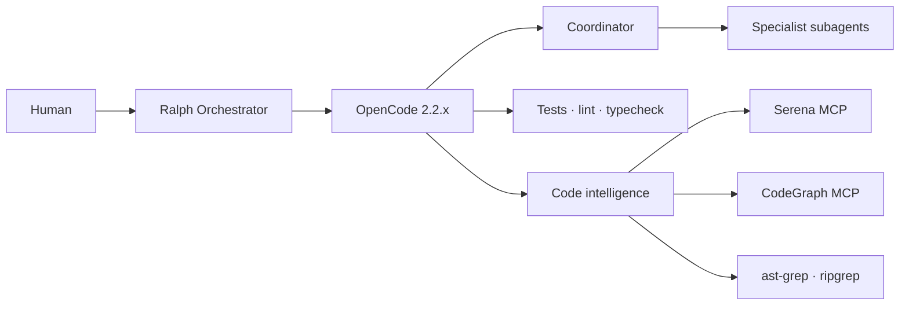

<p align="center">
  <picture>
    <source media="(prefers-color-scheme: dark)" srcset="assets/logo-dark.svg">
    
  </picture>
</p>

<h1 align="center">OPENCODE-TOOL-ENHANCER</h1>

<p align="center">
  <strong>A production-grade OpenCode profile with sourced agents, Ralph orchestration, and a code-intelligence stack.</strong>
</p>

<p align="center">
  
  
  
</p>

<p align="center">
  <a href="#quick-start">Quick start</a> ·
  <a href="#the-agent-team">Agents</a> ·
  <a href="#skills">Skills</a> ·
  <a href="#ralph-workflows">Orchestration</a> ·
  <a href="#code-intelligence">Code intelligence</a> ·
  <a href="#safety-and-governance">Safety</a> ·
  <a href="#provenance">Provenance</a>
</p>

---

## Why this exists

OpenCode is a strong coding agent, but a default installation is still a single general-purpose agent with an open-ended toolset. That works for small tasks and becomes expensive, inconsistent, and hard to audit on real repositories.

This repository provides a **complete, reproducible profile** that changes the default operating model:

- a custom primary agent that plans and delegates instead of editing everything itself;
- eleven specialized subagents with least-privilege permissions;
- Ralph Orchestrator for multi-step work, review gates, and persistent state;
- a code-intelligence stack that retrieves symbols and structure instead of whole files;
- explicit rules for provenance, Git safety, and documentation comments.

The goal is not the smallest prompt. The goal is the **lowest total cost for a correct result**.

## Architecture



Ralph owns the loop and quality gates. OpenCode owns agent behavior, permissions, tools, and context. Deterministic tools provide evidence without spending model tokens.

## Quick start

### 1. Prerequisites

- macOS or Linux. Windows is best-effort; use WSL or Git Bash.
- `git`, Node.js 20 or newer, `python3`, and `ripgrep`.
- An OpenCode provider credential, configured with `opencode auth login`.

### 2. Inspect the installer

```bash
git clone <repository-url> OPENCODE-TOOL-ENHANCER
cd OPENCODE-TOOL-ENHANCER

./scripts/installation/install.sh --check
./scripts/installation/install.sh --dry-run --all
```

The installer defaults to check-only, prints every action, and never edits `~/.config/opencode`.

### 3. Install the OpenCode profile

```bash
./scripts/installation/install.sh --apply --only opencode,agents,commands,skills,ralph
```

This writes `.opencode/` and `.ralph/` in the current project. To target another project, add `--target /path/to/project`. To replace an existing installation without leaving removed files behind, add `--clean`.

### 4. Install the code-intelligence tools

```bash
./scripts/installation/install.sh --apply --only ast-grep,serena
```

Serena and ast-grep are installed by the script. CodeGraph uses its upstream installer and then indexes each project with `codegraph init`; see [code intelligence](docs/installation/code-intelligence.md). The optional Repomix and jCodeMunch servers are present in the configuration but disabled by default.

### 5. Verify

```bash
opencode --version
opencode debug agents
opencode mcp list
./scripts/validation/validate.sh
```

Expected: OpenCode 2.2.x and `coordinator` plus eleven subagents. After Serena and CodeGraph are installed, `opencode mcp list` should show both connected.

### 6. Run your first task

```bash
opencode run --agent coordinator "Summarize this repository and propose the next task"
```

For a multi-step feature with review gates, use Ralph in a **separate disposable clone**. Ralph 2.10.1 auto-commits during landing and has no switch to disable it, so do not run it in a repository that must remain uncommitted. See [Ralph orchestration](docs/orchestration/ralph.md#git-safety) for the isolated workflow.

## The agent team

`coordinator` is the custom primary agent. It cannot edit files. It plans, delegates, and verifies.

| Agent | Mode | Edits | Responsibility |
| --- | --- | --- | --- |
| `coordinator` | primary | no | Plans, delegates, enforces verification |
| `planner` | subagent | no | Ordered, verifiable implementation tasks |
| `researcher` | subagent | no | Repository and documentation evidence |
| `architect` | subagent | no | Boundaries, contracts, architecture decisions |
| `backend-developer` | subagent | yes | Server, API, CLI, and business logic |
| `frontend-developer` | subagent | yes | UI, state, accessibility, visual consistency |
| `database-specialist` | subagent | yes | Schemas, queries, migrations, indexes |
| `code-reviewer` | subagent | no | Independent defect and regression review |
| `test-engineer` | subagent | yes | Unit, integration, and end-to-end tests |
| `security-reviewer` | subagent | no | Exploitable vulnerabilities and unsafe patterns |
| `performance-analyst` | subagent | no | Baselines, profiles, and measured regressions |
| `documentation-engineer` | subagent | docs only | Documentation that matches the code |

See [agent roles and delegation](docs/agents/roles.md) for the delegation rules and Ralph mapping.

## Skills

All skills are adapted from maintained upstream repositories and keep their original authors.

| Skill | Author | Use it for |
| --- | --- | --- |
| `test-driven-development` | Jesse Vincent | Red-green-refactor with real failing tests |
| `systematic-debugging` | Jesse Vincent | Hypotheses, reproduction, and root-cause fixes |
| `writing-plans` | Jesse Vincent | Plans that a junior engineer can execute |
| `verification-before-completion` | Jesse Vincent | Evidence before declaring done |
| `requesting-code-review` | Jesse Vincent | Preparing work for independent review |
| `api-design-principles` | Seth Hobson | REST and GraphQL contract design |
| `database-migration` | Seth Hobson | Zero-downtime, reversible migrations |
| `code-review-excellence` | Seth Hobson | Constructive, systematic code review |
| `auth-implementation-patterns` | Seth Hobson | JWT, OAuth2, sessions, and RBAC |
| `changelog-automation` | Seth Hobson | Release notes and versioning |

## Commands

| Command | Agent | Purpose |
| --- | --- | --- |
| `/implement` | `coordinator` | End-to-end feature development |
| `/review` | `coordinator` | Multi-dimensional code review |
| `/debug` | `coordinator` | Reproduce, localize, and fix a defect |
| `/security` | `security-reviewer` | Static application security testing |
| `/docs` | `documentation-engineer` | Generate and refresh documentation |
| `/refactor` | `backend-developer` | Behavior-preserving cleanup |
| `/db` | `database-specialist` | SQL migrations and zero-downtime changes |
| `/perf` | `performance-analyst` | Profiling to monitoring |

## Ralph workflows

Ralph collections are extracted from the official presets. Only per-hat OpenCode agent routing is added.

| Collection | Hats | Best for |
| --- | --- | --- |
| `code-assist` | planner, builder, critic, finalizer | Multi-step implementation with review |
| `review` | reviewer, analyzer, closer | Read-only multi-perspective review |
| `research` | researcher, synthesizer | Evidence gathering without code changes |
| `debug` | investigator, tester, fixer, verifier | Reproduction, hypothesis, fix, verification |

> **Auto-commit warning:** Ralph 2.10.1 commits its own changes during landing and exposes no switch to disable it. Run it only in a separate disposable clone. A linked worktree is not sufficient because it shares `.git` with your repository. See [Ralph orchestration](docs/orchestration/ralph.md#git-safety).

Inside a separate disposable clone:

```bash
ralph run -c configs/ralph/ralph.yml -H configs/ralph/hats/research.yml -p "Research <question>"
```

## Code intelligence

| Tool | Integration | Role | Default |
| --- | --- | --- | --- |
| native `read`, `glob`, `grep` | built-in | Targeted discovery | yes |
| ripgrep | CLI | Exact text and error search | yes |
| ast-grep | CLI | Structural search and rewrites | yes |
| Serena | MCP | Symbol navigation and refactoring | yes |
| CodeGraph | MCP | Cross-file dependencies and blast radius | yes |
| Repomix | MCP | Whole-repository snapshots | optional |
| jCodeMunch | MCP | Symbol retrieval; commercial license | optional |

The default profile uses Code Mode and permission filtering to control MCP schema overhead. The minimal profile, `configs/opencode/minimal.jsonc`, disables MCP entirely.

## Configuration highlights

| Setting | Value | Why |
| --- | --- | --- |
| `default_agent` | `coordinator` | No reliance on the default Build agent |
| `permissions` | ordered allow/ask/deny | Least privilege and hard git denies |
| `mcp.servers` | Serena, CodeGraph; optional servers disabled | Useful defaults without schema bloat |
| `compaction.keep.tokens` | `12000` | Bounded recent context |
| `compaction.buffer` | `15%` | Room before overflow |
| `tool_output` | 2000 lines / 51200 bytes | One command cannot flood context |
| `experimental.subagent_depth` | `1` | No recursive agent spawning |

Model routing is optional and environment-driven. Start with [model-routing.example.jsonc](configs/opencode/model-routing.example.jsonc) and [the configuration guide](docs/configuration/opencode-v2.md).

## Safety and governance

This repository is intentionally strict about automation.

- **No automatic staging or commits.** Agents leave changes unstaged and return the diff. Git write commands are denied in configuration and validated per agent.
- **No greenfield artifacts.** Agents, skills, commands, and hats are sourced, pinned, attributed, and modified minimally. See [provenance](docs/provenance/README.md).
- **Documentation comments only.** File headers and function documentation; no inline comments or field-level configuration comments.
- **Destructive commands are denied.** `sudo`, `rm -rf`, force-push, and destructive git operations are blocked or require approval.
- **Installer defaults to inspection.** `--check` and `--dry-run` are safe; `--apply` is explicit and creates a backup.

These rules are documented in [AGENTS.md](AGENTS.md) Sections 2A, 2B, and 2C.

## Provenance

No skill or agent is original work. Each is adapted from a maintained MIT-licensed collection.

| Source | Author | Used for |
| --- | --- | --- |
| [VoltAgent/awesome-claude-code-subagents](https://github.com/VoltAgent/awesome-claude-code-subagents) | VoltAgent | Generic role agents |
| [wshobson/agents](https://github.com/wshobson/agents) | Seth Hobson | Coordinator, architect, database, skills, commands |
| [obra/superpowers](https://github.com/obra/superpowers) | Jesse Vincent | TDD, debugging, planning, verification, review skills |
| [mikeyobrien/ralph-orchestrator](https://github.com/mikeyobrien/ralph-orchestrator) | Ralph Orchestrator Contributors | Official hat presets |

Every artifact records its source path, commit, license, author, and local modifications in [docs/provenance/registry.yml](docs/provenance/registry.yml). License texts are in [THIRD_PARTY_NOTICES.md](THIRD_PARTY_NOTICES.md).

## Benchmarks

The benchmark harness is reproducible, but **no results are published yet**. This is deliberate: token savings without correctness and rework data are not a result.

- [Methodology](docs/benchmarks/methodology.md)
- [Tasks](benchmarks/tasks)
- [Harness](benchmarks/harness)
- [Results](benchmarks/results)

## Repository map

```text
.
├── assets/                         # logo and mark
├── agents/<role>/AGENT.md          # canonical agent definitions
├── skills/<name>/SKILL.md          # sourced skills
├── commands/                       # sourced slash commands
├── configs/
│   ├── opencode/                   # OpenCode V2 profiles
│   └── ralph/                      # core config and hat collections
├── docs/                           # research, decisions, guides, provenance
├── examples/                       # TypeScript, C#, multi-agent fixtures
├── benchmarks/                     # methodology, tasks, harness, results
├── scripts/                        # install, validate, benchmark, maintain
├── AGENTS.md                       # engineering rules
├── THIRD_PARTY_NOTICES.md
└── README.md
```

## Troubleshooting

- [Troubleshooting guide](docs/troubleshooting/README.md)
- [Validation checklist](docs/validation-checklist.md)
- [Compatibility matrix](docs/research/compatibility-matrix.md)

Common checks:

```bash
./scripts/validation/validate.sh
opencode debug agents
opencode mcp list
ralph preflight -c configs/ralph/ralph.yml --format human
```

## Contributing

Contributions must follow the provenance, Git safety, and documentation-comment rules in [AGENTS.md](AGENTS.md). See [CONTRIBUTING.md](CONTRIBUTING.md) for the workflow and validation commands.

## License

Repository content is MIT. Third-party artifacts keep their original licenses; see [THIRD_PARTY_NOTICES.md](THIRD_PARTY_NOTICES.md). Serena is GPL-3.0-or-later and is installed as an external tool, not vendored here.
