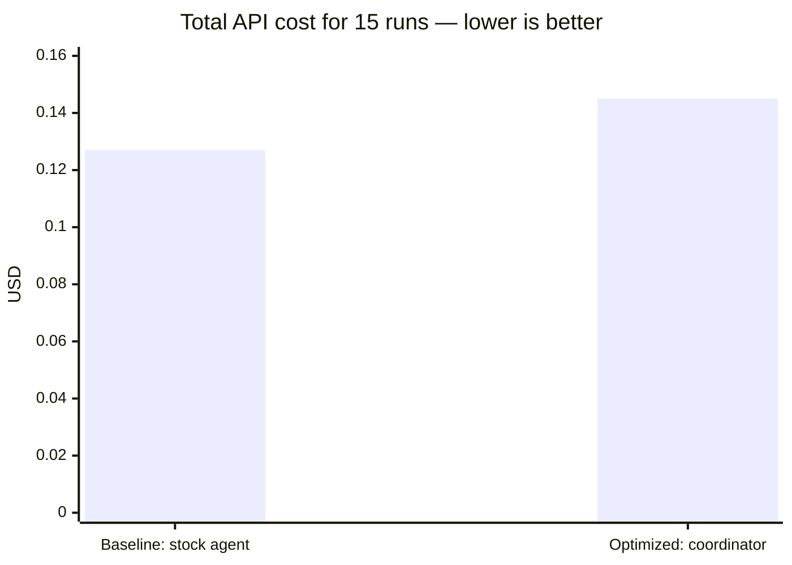
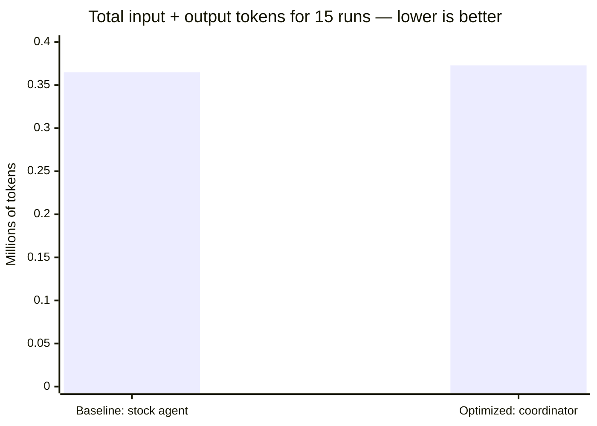
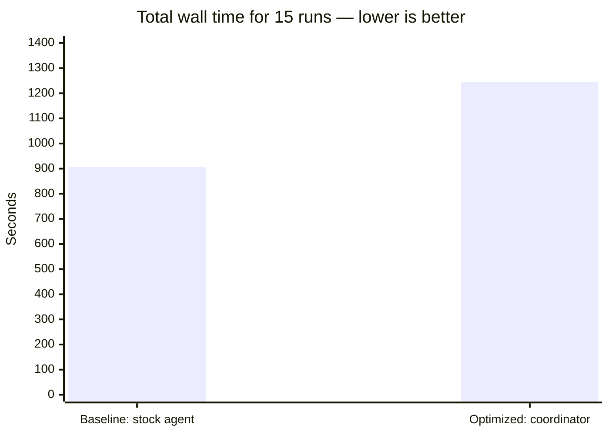
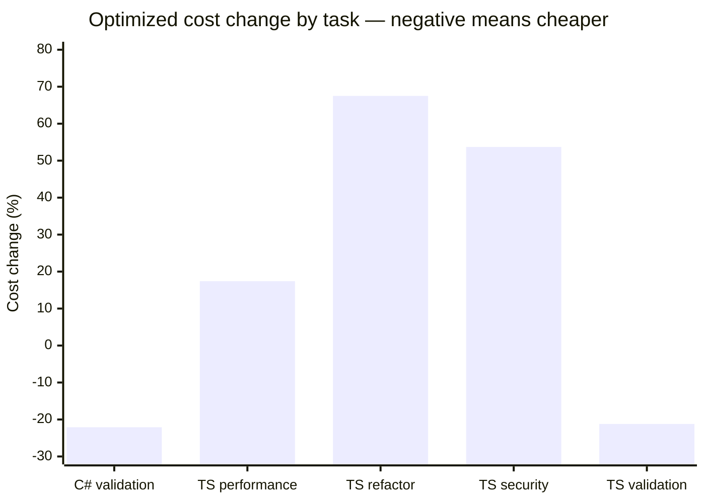

# DeepSeek Flash Benchmark Results

> **Status:** Experimental · **Last verified:** 2026-11-13 · **Evidence:** 30 isolated harness runs on `deepseek/deepseek-flash`; artifacts under [`benchmarks/results/deepseek-flash-2026-11-13/`](https://github.com/GabrielAlmeidaFlores/ToolWright/tree/main/benchmarks/results/deepseek-flash-2026-11-13)

## The short answer

The optimized configuration **did not save money** on this benchmark.

It cost **14.2% more overall**, used **2.3% more tokens**, and took **37.3% longer** than the baseline. Both arms passed every verification command.

The result is mixed rather than a uniform regression:

- The optimized arm was **cheaper by about 21–22%** on C# validation and TypeScript validation.
- It was **more expensive** on TypeScript performance, refactor, and security, with increases from **17.4% to 67.5%**.
- It used **fewer tool calls overall** but generated **much more output and reasoning**, which raised cost and wall time.

> **Verdict:** do not present this optimized configuration as a cost optimization on these tasks. It is an overall negative result with task-level wins, and negative results are valid evidence.

## What was compared

This benchmark answers one question:

> Does the ToolWright optimized configuration complete the same tasks correctly at a lower total cost than a stock OpenCode configuration?

| Arm | Configuration | Agent | What it represents |
|---|---|---|---|
| **Baseline** | Stock OpenCode config | `build` | The default starting point |
| **Optimized** | [`configs/opencode/opencode.jsonc`](https://github.com/GabrielAlmeidaFlores/ToolWright/blob/main/configs/opencode/opencode.jsonc) | `coordinator` | ToolWright's customized workflow |

Both arms used:

- the same source commit: `a7983f8` (`v0.4.0`);
- the same model: `deepseek/deepseek-flash`;
- the same five tasks;
- three independent repeats per task per arm;
- one fresh disposable clone per run;
- the same verification commands.

The optimized arm also installed the minimal ToolWright profile, so the coordinator and supporting artifacts were present. The baseline used the stock agent and no custom profile.

### Data source and correction

Cost, token, step, and tool-call values on this page come from summing each run's `session.jsonl` step and tool events into `run-stats.json`. That file is the per-run source of truth.

The earlier version of this page used `opencode stats --project .`. That command aggregated sessions that shared a project identity across the isolated clones, so later runs appeared more expensive than they were. The correction changed the aggregate from **+6.0%** to **+14.2%** and revealed that the optimized arm is cheaper on two tasks rather than more expensive on all five. Raw `stats.json` files remain in the artifacts for inspection but are not used for any number on this page.

## How to read the numbers

| Metric | Meaning | Better direction |
|---|---|---|
| Cost | Total API spend summed from session events | Lower |
| Input tokens | Tokens sent to the model | Lower, if quality is equal |
| Output tokens | Tokens generated by the model | Lower, if quality is equal |
| Wall time | End-to-end run time | Lower |
| Verification | Whether the task's test command passed | Higher |
| Correctness score | Verification plus changed-path scope | Higher |
| Rework | Follow-up prompts or human corrections | Lower |

A cheaper run is **not** a win when it fails verification, produces worse code, or needs more rework.

## Chart 1: total cost across all 15 runs

Each bar is the sum of 15 runs for that arm: five tasks times three repeats.



- Baseline: **$0.127190** total, about **$0.00848 per run**
- Optimized: **$0.145288** total, about **$0.00969 per run**
- Optimized increase: **+$0.018098 (+14.2%)**

## Chart 2: total tokens across all 15 runs

This counts input plus output tokens. It does not include cached reads separately.



- Baseline: **365,019 tokens**, about **24,335 per run**
- Optimized: **373,496 tokens**, about **24,900 per run**
- Optimized increase: **+8,477 tokens (+2.3%)**

## Chart 3: total wall time across all 15 runs

Wall time measures elapsed seconds, including model latency and tool execution.



- Baseline: **906 seconds**, about **60.4 seconds per run**
- Optimized: **1,244 seconds**, about **82.9 seconds per run**
- Optimized increase: **+338 seconds (+37.3%)**

## Chart 4: optimized cost change by task

Cost changed in both directions. A negative bar means the optimized arm was cheaper; a positive bar means it was more expensive. The percentage is the optimized median cost divided by the baseline median cost, minus one.



Two tasks became cheaper: C# validation at **−22.1%** and TypeScript validation at **−21.2%**. Three became more expensive: TypeScript performance at **+17.4%**, security at **+53.7%**, and refactor at **+67.5%**.

## Per-task detail

The table uses **medians** for each task and arm, not totals. Each median is calculated from three runs, so small differences are noise-sensitive.

| Task | Baseline cost | Optimized cost | Cost change | Baseline tokens in/out | Optimized tokens in/out | Baseline wall | Optimized wall | Score baseline/optimized |
|---|---:|---:|---:|---:|---:|---:|---:|---:|
| `cs-validation` | $0.013361 | $0.010413 | −22.1% | 24,297 / 4,482 | 19,853 / 5,643 | 99s | 79s | 4 / 4 |
| `ts-perf` | $0.006594 | $0.007744 | +17.4% | 19,025 / 2,084 | 19,434 / 3,169 | 40s | 94s | 4 / 3 |
| `ts-refactor` | $0.003752 | $0.006283 | +67.5% | 15,869 / 1,486 | 16,831 / 2,640 | 26s | 41s | 4 / 4 |
| `ts-security` | $0.006424 | $0.009875 | +53.7% | 17,507 / 2,561 | 21,508 / 3,499 | 41s | 75s | 4 / 4 |
| `ts-validation` | $0.012783 | $0.010068 | −21.2% | 28,410 / 3,827 | 22,456 / 4,452 | 74s | 62s | 4 / 3 |

### What changed in each task

These observations come from the first repeat's diffs and the median metrics. They describe the shape of the work, not a line-by-line code review.

- **C# validation:** both arms changed `Example/Program.cs` and added or extended tests. The optimized arm added a focused `EndpointTests.cs` file and also updated the example README and AGENTS file. It used 13 steps and 17 tool calls versus 23 and 31 for the baseline, and cost 22.1% less.
- **TypeScript validation:** the baseline added `endpoint.ts` and an endpoint test file, then wired it into the existing tests. The optimized arm extended `validation.ts`, added `validation.test.ts`, and changed the example README. It used 12 steps and 16 tool calls versus 14 and 22, and cost 21.2% less.
- **TypeScript performance:** both arms changed `repository.ts` and `app.test.ts` to batch order loading and protect the query count. The optimized arm spent more output and reasoning tokens and, in two repeats, also edited the example documentation. Median cost rose 17.4%.
- **TypeScript refactor:** both arms extracted pricing logic in `pricing.ts` and updated `app.test.ts`. The optimized arm took more steps and wrote more test and reasoning output. Median cost rose 67.5%, the largest relative loss in the set.
- **TypeScript security:** both arms hardened `files.ts` and added traversal tests. The optimized arm added broader encoded-traversal coverage and a multi-pass decode path, producing more output and reasoning. Median cost rose 53.7%.

The common pattern is not “the coordinator always does more work.” It is that the coordinator sometimes finds a shorter path and sometimes expands the task. The benchmark measures the result, not the intent.


## Correctness

All **30 of 30** verification commands passed.

| Arm | Score 4 | Score 3 | Score 2 | Score 1 | Score 0 |
|---|---:|---:|---:|---:|---:|
| Baseline | 14 | 1 | 0 | 0 | 0 |
| Optimized | 11 | 4 | 0 | 0 | 0 |

### What the scores mean

| Score | Meaning |
|---:|---|
| 4 | Verification passed and every changed file was inside the task's declared areas |
| 3 | Verification passed, but at least one unrelated file changed |
| 2 | Verification passed only after a fix cycle |
| 1 | Verification still failed or behavior was incomplete |
| 0 | Incorrect, unsafe, or destructive result |

Score-3 runs were not failures. They passed their tests but changed documentation outside the task scope:

- Baseline: one run changed [`examples/typescript/AGENTS.md`](https://github.com/GabrielAlmeidaFlores/ToolWright/blob/main/examples/typescript/AGENTS.md).
- Optimized: three runs changed [`examples/typescript/README.md`](https://github.com/GabrielAlmeidaFlores/ToolWright/blob/main/examples/typescript/README.md), and two changed [`AGENTS.md`](https://github.com/GabrielAlmeidaFlores/ToolWright/blob/main/AGENTS.md). One run changed both.

## Why the result is mixed

The optimized arm did less tool work in total, but it produced much more output and reasoning.

| Signal | Baseline | Optimized | Change |
|---|---:|---:|---:|
| Input tokens | 318,344 | 311,430 | −2.2% |
| Output tokens | 46,675 | 62,066 | +33.0% |
| Reasoning tokens | 64,633 | 80,544 | +24.6% |
| Total input + output | 365,019 | 373,496 | +2.3% |
| Steps | 195 | 186 | −4.6% |
| Tool calls | 278 | 233 | −16.2% |
| Wall time | 906s | 1,244s | +37.3% |

The per-task pattern explains the aggregate:

| Task | Baseline steps | Optimized steps | Baseline tool calls | Optimized tool calls | Cost change |
|---|---:|---:|---:|---:|---:|
| `cs-validation` | 23 | 13 | 31 | 17 | −22.1% |
| `ts-perf` | 10 | 10 | 17 | 14 | +17.4% |
| `ts-refactor` | 7 | 10 | 9 | 13 | +67.5% |
| `ts-security` | 12 | 15 | 14 | 16 | +53.7% |
| `ts-validation` | 14 | 12 | 22 | 16 | −21.2% |

The optimized arm was efficient when the coordinator stayed on the shortest path. On C# validation and TypeScript validation it used fewer steps and fewer tool calls, and it cost less.

On refactor, security, and performance it used more steps and more tool calls, and it wrote substantially more output and reasoning. That is the opposite of the intended saving: the coordinator spent tokens deciding what to do and explaining what it had done.

Wall time moved independently of token cost. Even where tool calls dropped, the optimized arm was slower on three of five tasks and faster on C# validation and TypeScript validation. The likely contributors are extra reasoning, extra model round trips, and the optimized configuration's larger runtime surface. The benchmark does not isolate which factor dominates.

The honest summary is: **the current optimized profile helps some tasks and hurts others. On this task set, the losses are larger than the wins.**

## What this result does and does not prove

This result proves that, for these five small tasks with this one model, the current optimized profile is **14.2% more expensive overall** than the baseline, even though it wins on two tasks.

It does **not** prove that:

- every ToolWright configuration is more expensive;
- the coordinator always loses on small tasks;
- validation tasks will always be cheaper with the coordinator;
- the coordinator is useless on larger tasks;
- another model would behave the same way;
- a slimmer profile cannot beat the baseline.

## What to test next

1. **Slim coordinator:** reduce planning and delegation on tasks that do not need them.
2. **Regression focus:** inspect the refactor and security runs to see why reasoning and output grew so much.
3. **Preserve the wins:** identify what made C# and TypeScript validation cheaper and keep that path.
4. **Task-size split:** compare small, medium, and large repositories separately.
5. **Minimal profile:** test whether tools alone beat the coordinator profile.
6. **Second model:** repeat with a stronger model and a cheaper model family.
7. **Rework measurement:** add follow-up turns and human corrections to the rubric.

## Reproduce it

The harness, tasks, and per-run artifacts are available:

- [Benchmark methodology](methodology.md)
- [Harness](https://github.com/GabrielAlmeidaFlores/ToolWright/blob/main/benchmarks/harness/run.sh)
- [Task definitions](https://github.com/GabrielAlmeidaFlores/ToolWright/tree/main/benchmarks/tasks)
- [Run artifacts](https://github.com/GabrielAlmeidaFlores/ToolWright/tree/main/benchmarks/results/deepseek-flash-2026-11-13)
- [Adapter validation record](../installation/adapter-validation.md)

```bash
OPENCODE_BENCH_MODEL=deepseek/deepseek-flash \
  ./benchmarks/harness/run.sh --arm baseline \
  --task benchmarks/tasks/ts-validation.json

OPENCODE_BENCH_MODEL=deepseek/deepseek-flash \
  ./benchmarks/harness/run.sh --arm optimized \
  --task benchmarks/tasks/ts-validation.json
```

## Limitations

- One model only: `deepseek/deepseek-flash`.
- Small example repositories.
- Three repeats per task; the numbers are medians, not a significance test.
- Correctness combines the verification command with an automated changed-path check. There was no independent blind review.
- Rework and human intervention were not exercised.
- Cost depends on provider pricing at run time.
- Published cost and token numbers are recomputed from each run's `session.jsonl` step events. The `opencode stats --project .` output was cumulative across runs that shared a project identity and is retained only as `stats.json`; it is not used for any result on this page.
- The harness now writes `run-stats.json` from the session log so future runs do not repeat that aggregation error.
- Optimized metadata records the disposable fixture commit `a8eb1be` because the installed profile was committed into the clone. The source code under test is `a7983f8` in both arms.

## Artifacts

Each run directory contains `meta.json`, `stats.json`, `run-stats.json`, `session.jsonl`, `export.json`, `verification.log`, `diff.patch`, `status.txt`, and `notes.md`.

Start with the [aggregate summary](https://github.com/GabrielAlmeidaFlores/ToolWright/blob/main/benchmarks/results/deepseek-flash-2026-11-13/summary.json) or the per-run `notes.md`.
