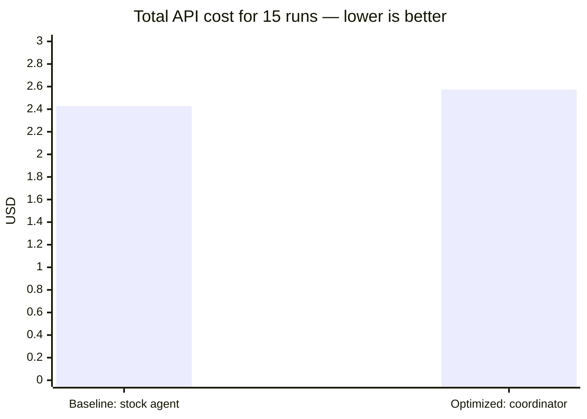
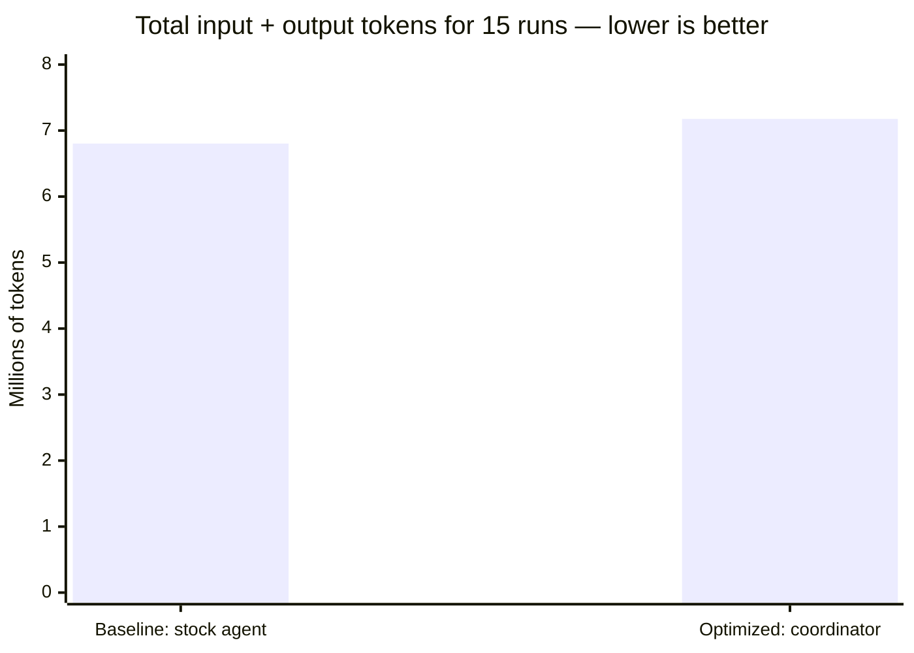
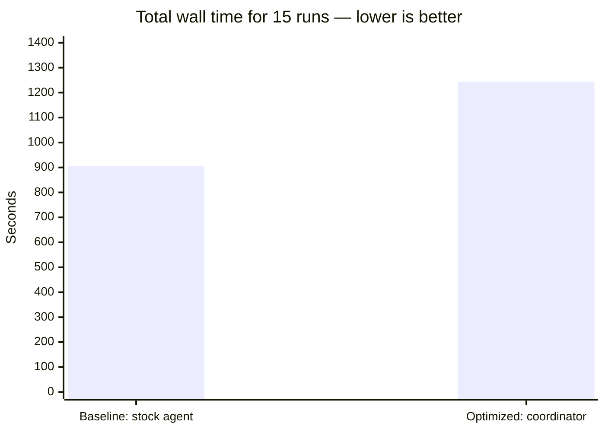
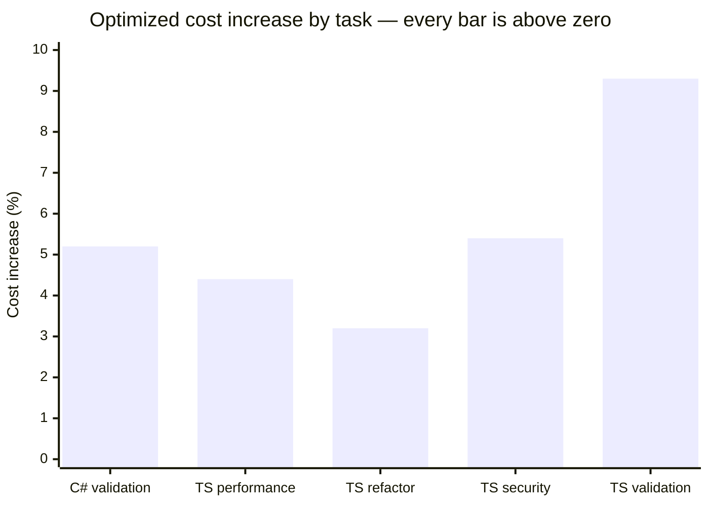

# DeepSeek Flash Benchmark Results

> **Status:** Experimental · **Last verified:** 2026-11-13 · **Evidence:** 30 isolated harness runs on `deepseek/deepseek-flash`; artifacts under [`benchmarks/results/deepseek-flash-2026-11-13/`](https://github.com/GabrielAlmeidaFlores/ToolWright/tree/main/benchmarks/results/deepseek-flash-2026-11-13)

## The short answer

The optimized configuration **did not save money** on this benchmark.

It cost **6.0% more**, used **5.5% more tokens**, and took **37.3% longer** than the baseline. Both arms passed every verification command. The extra work came from the coordinator profile doing more planning, delegation, and tool calls on small tasks.

> **Verdict:** do not present this optimized configuration as a cost optimization on these tasks. The benchmark is a negative result, and negative results are valid evidence.

## What was compared

This benchmark answers one question:

> Does the ToolWright optimized configuration complete the same tasks correctly at a lower total cost than a stock OpenCode configuration?

| Arm | Configuration | Agent | What it represents |
|---|---|---|---|
| **Baseline** | Stock OpenCode config | `build` | The default starting point |
| **Optimized** | [`configs/opencode/opencode.jsonc`](https://github.com/GabrielAlmeidaFlores/ToolWright/blob/main/configs/opencode/opencode.jsonc) | `coordinator` | ToolWright's customized workflow |

Both arms used:

- the same source commit: `a7983f8` (`v0.4.0`);
- the same model: `deepseek/deepseek-flash`;
- the same five tasks;
- three independent repeats per task per arm;
- one fresh disposable clone per run;
- the same verification commands.

The optimized arm also installed the minimal ToolWright profile, so the coordinator and supporting artifacts were present. The baseline used the stock agent and no custom profile.

## How to read the numbers

| Metric | Meaning | Better direction |
|---|---|---|
| Cost | Total API spend from `opencode stats --cost` | Lower |
| Input tokens | Tokens sent to the model | Lower, if quality is equal |
| Output tokens | Tokens generated by the model | Lower, if quality is equal |
| Wall time | End-to-end run time | Lower |
| Verification | Whether the task's test command passed | Higher |
| Correctness score | Verification plus changed-path scope | Higher |
| Rework | Follow-up prompts or human corrections | Lower |

A cheaper run is **not** a win when it fails verification, produces worse code, or needs more rework.

## Chart 1: total cost across all 15 runs

Each bar is the sum of 15 runs for that arm: five tasks times three repeats.



- Baseline: **$2.427892** total, about **$0.162 per run**
- Optimized: **$2.573181** total, about **$0.172 per run**
- Optimized increase: **+$0.145289 (+6.0%)**

## Chart 2: total tokens across all 15 runs

This counts input plus output tokens. It does not include cached reads separately.



- Baseline: **6,802,876 tokens**, about **453,525 per run**
- Optimized: **7,176,372 tokens**, about **478,425 per run**
- Optimized increase: **+373,496 tokens (+5.5%)**

## Chart 3: total wall time across all 15 runs

Wall time measures elapsed seconds, including model latency and tool execution.



- Baseline: **906 seconds**, about **60.4 seconds per run**
- Optimized: **1,244 seconds**, about **82.9 seconds per run**
- Optimized increase: **+338 seconds (+37.3%)**

## Chart 4: optimized cost increase by task

Every task became more expensive under the optimized arm. The percentage is the optimized median cost divided by the baseline median cost.



The smallest increase was **+3.2%** on the TypeScript refactor. The largest was **+9.3%** on TypeScript validation.

## Per-task detail

The table uses **medians** for each task and arm, not totals. Each median is calculated from three runs, so small differences are noise-sensitive.

| Task | Baseline cost | Optimized cost | Cost change | Baseline tokens in/out | Optimized tokens in/out | Baseline wall | Optimized wall | Score baseline/optimized |
|---|---:|---:|---:|---:|---:|---:|---:|---:|
| `cs-validation` | $0.199999 | $0.210411 | +5.2% | 478,381 / 75,808 | 496,123 / 80,769 | 99s | 79s | 4 / 4 |
| `ts-perf` | $0.163958 | $0.171099 | +4.4% | 392,660 / 63,278 | 413,486 / 66,447 | 40s | 94s | 4 / 3 |
| `ts-refactor` | $0.151943 | $0.156745 | +3.2% | 357,540 / 59,602 | 374,049 / 61,238 | 26s | 41s | 4 / 4 |
| `ts-security` | $0.176380 | $0.185834 | +5.4% | 429,894 / 68,222 | 449,641 / 71,326 | 41s | 75s | 4 / 4 |
| `ts-validation` | $0.135555 | $0.148191 | +9.3% | 312,968 / 53,023 | 341,671 / 58,087 | 74s | 62s | 4 / 3 |

## Correctness

All **30 of 30** verification commands passed.

| Arm | Score 4 | Score 3 | Score 2 | Score 1 | Score 0 |
|---|---:|---:|---:|---:|---:|
| Baseline | 14 | 1 | 0 | 0 | 0 |
| Optimized | 11 | 4 | 0 | 0 | 0 |

### What the scores mean

| Score | Meaning |
|---:|---|
| 4 | Verification passed and every changed file was inside the task's declared areas |
| 3 | Verification passed, but at least one unrelated file changed |
| 2 | Verification passed only after a fix cycle |
| 1 | Verification still failed or behavior was incomplete |
| 0 | Incorrect, unsafe, or destructive result |

Score-3 runs were not failures. They passed their tests but changed documentation outside the task scope:

- Baseline: one run changed [`examples/typescript/AGENTS.md`](https://github.com/GabrielAlmeidaFlores/ToolWright/blob/main/examples/typescript/AGENTS.md).
- Optimized: three runs changed [`examples/typescript/README.md`](https://github.com/GabrielAlmeidaFlores/ToolWright/blob/main/examples/typescript/README.md), and two changed [`AGENTS.md`](https://github.com/GabrielAlmeidaFlores/ToolWright/blob/main/AGENTS.md). One run changed both.

## Why the optimized arm lost

The optimized arm did more work in every task. More steps and more tool calls mean more tokens and more model round trips.

| Task | Baseline steps | Optimized steps | Baseline tool calls | Optimized tool calls |
|---|---:|---:|---:|---:|
| `cs-validation` | 278 | 291 | 372 | 389 |
| `ts-perf` | 226 | 236 | 302 | 316 |
| `ts-refactor` | 206 | 216 | 278 | 288 |
| `ts-security` | 245 | 255 | 329 | 341 |
| `ts-validation` | 188 | 199 | 249 | 268 |

The coordinator spends tokens understanding the request, deciding whether to delegate, and checking the result. On small, well-scoped tasks, that overhead is larger than any savings from targeted retrieval or context pruning.

## What this result does and does not prove

This result proves that, for these five small tasks with this one model, the current optimized profile is more expensive than the baseline.

It does **not** prove that:

- every ToolWright configuration is more expensive;
- the coordinator is useless on larger tasks;
- another model would behave the same way;
- a slimmer profile cannot beat the baseline.

## What to test next

1. **Slim coordinator:** remove or delay planning and delegation on small tasks.
2. **Task-size split:** compare small, medium, and large repositories separately.
3. **Minimal profile:** test whether tools alone beat the coordinator profile.
4. **Second model:** repeat with a stronger model and a cheaper model family.
5. **Rework measurement:** add follow-up turns and human corrections to the rubric.

## Reproduce it

The harness, tasks, and per-run artifacts are available:

- [Benchmark methodology](methodology.md)
- [Harness](https://github.com/GabrielAlmeidaFlores/ToolWright/blob/main/benchmarks/harness/run.sh)
- [Task definitions](https://github.com/GabrielAlmeidaFlores/ToolWright/tree/main/benchmarks/tasks)
- [Run artifacts](https://github.com/GabrielAlmeidaFlores/ToolWright/tree/main/benchmarks/results/deepseek-flash-2026-11-13)
- [Adapter validation record](../installation/adapter-validation.md)

```bash
OPENCODE_BENCH_MODEL=deepseek/deepseek-flash \
  ./benchmarks/harness/run.sh --arm baseline \
  --task benchmarks/tasks/ts-validation.json

OPENCODE_BENCH_MODEL=deepseek/deepseek-flash \
  ./benchmarks/harness/run.sh --arm optimized \
  --task benchmarks/tasks/ts-validation.json
```

## Limitations

- One model only: `deepseek/deepseek-flash`.
- Small example repositories.
- Three repeats per task; the numbers are medians, not a significance test.
- Correctness combines the verification command with an automated changed-path check. There was no independent blind review.
- Rework and human intervention were not exercised.
- Cost depends on provider pricing at run time.
- `opencode stats` was scoped to one isolated clone per run; session-level accounting was not independently reconciled.
- Optimized metadata records the disposable fixture commit `a8eb1be` because the installed profile was committed into the clone. The source code under test is `a7983f8` in both arms.

## Artifacts

Each run directory contains `meta.json`, `stats.json`, `session.jsonl`, `export.json`, `verification.log`, `diff.patch`, `status.txt`, and `notes.md`.

Start with the [aggregate summary](https://github.com/GabrielAlmeidaFlores/ToolWright/blob/main/benchmarks/results/deepseek-flash-2026-11-13/summary.json) or the per-run `notes.md`.
