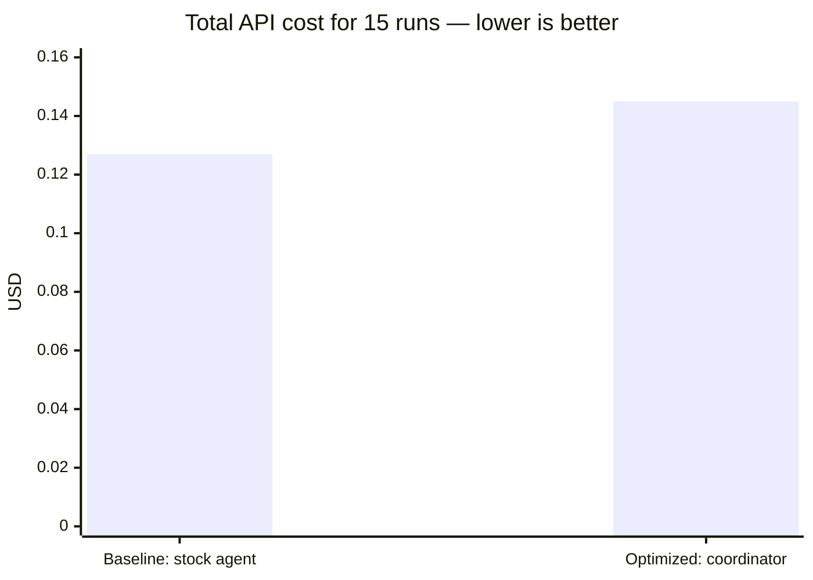
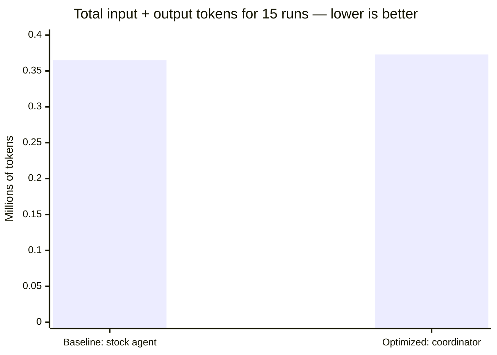
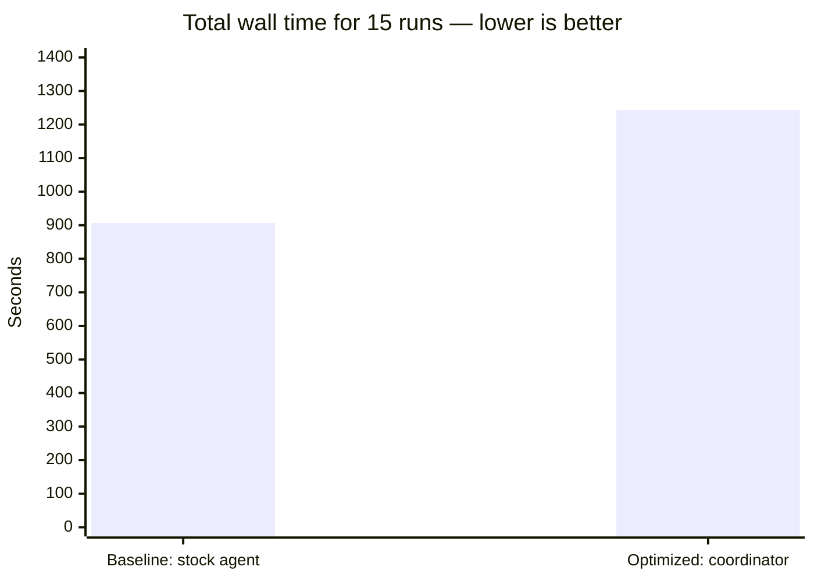
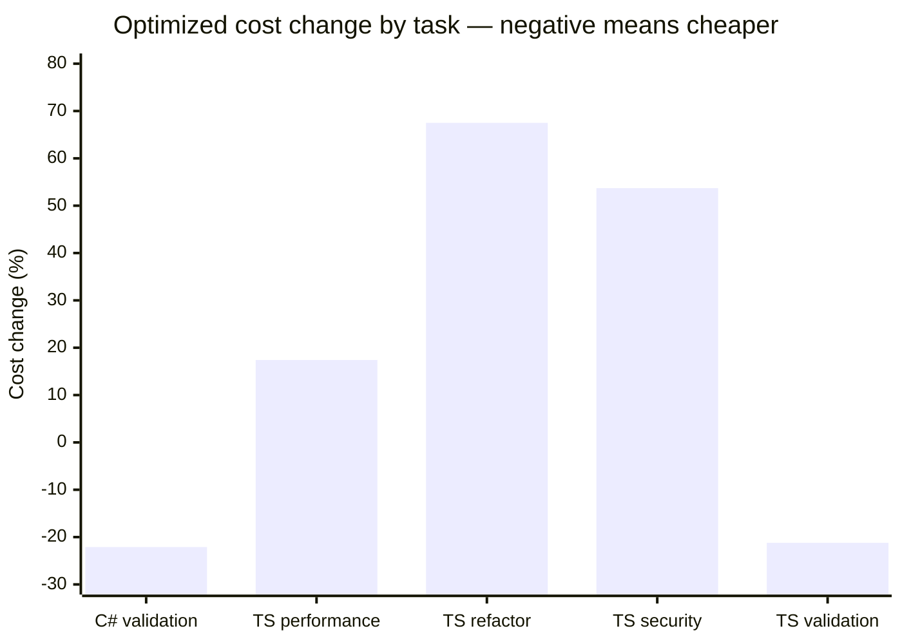

# DeepSeek Flash Benchmark Results

> **Status:** Experimental · **Last verified:** 2026-11-13 · **Evidence:** 30 isolated harness runs on `deepseek/deepseek-flash`; artifacts under [`benchmarks/results/deepseek-flash-2026-11-13/`](https://github.com/GabrielAlmeidaFlores/ToolWright/tree/main/benchmarks/results/deepseek-flash-2026-11-13)

## The short answer

The optimized configuration **did not save money** on this benchmark.

It cost **14.2% more overall**, used **2.3% more tokens**, and took **37.3% longer** than the baseline. Both arms passed every verification command.

The result is mixed rather than a uniform regression:

- The optimized arm was **cheaper by about 21–22%** on C# validation and TypeScript validation.
- It was **more expensive** on TypeScript performance, refactor, and security, with increases from **17.4% to 67.5%**.
- It used **fewer tool calls overall** but generated **much more output and reasoning**, which raised cost and wall time.

Cost per fully scoped success is the clearest summary. The baseline spent **$0.009085 per run that scored 4/4**. The optimized arm spent **$0.013208 per run that scored 4/4**, an increase of **45.4%**.

> **Verdict:** do not present this optimized configuration as a cost optimization on these tasks. It is an overall negative result with task-level wins, and negative results are valid evidence.

## What this document answers

This page answers one narrow question:

> Does the ToolWright optimized configuration complete the same tasks correctly at a lower total cost than a stock OpenCode configuration?

It does not answer whether ToolWright is useful for every repository, every model, or every task size. The result is specific to five small tasks, one model, one source commit, and three repeats.

## Experiment setup

Before reading any result, this table defines the experiment. The **Parameter** column names the fixed input to the experiment, the **Value** column records the exact setting, and the **Why it matters** column explains how that setting affects interpretation.

| Parameter | Value | Why it matters |
|---|---|---|
| Model | `deepseek/deepseek-flash` | Pricing, reasoning behavior, tool use, and latency are model-specific. |
| OpenCode | `2.2.7` | Harness behavior and configuration support can change between versions. |
| Source commit | `a7983f8` (`v0.4.0`) | Both arms must run the same code to make a fair comparison. |
| Tasks | 5 (C# validation, TypeScript validation, performance, refactor, security) | The task mix determines whether the result generalizes. |
| Repeats | 3 per task per arm | Three repeats expose some variance but are not a significance test. |
| Runs | 30 total (5 tasks × 2 arms × 3 repeats) | Total cost and total tokens below are sums over these runs. |
| Isolation | One fresh clone per run | Prevents one run from inheriting another run's file changes. |
| Baseline arm | Stock OpenCode config, `build` agent | Represents the default starting point. |
| Optimized arm | [`configs/opencode/opencode.jsonc`](https://github.com/GabrielAlmeidaFlores/ToolWright/blob/main/configs/opencode/opencode.jsonc), `coordinator` agent, minimal installed profile | Represents ToolWright's customized workflow. |
| Environment | macOS 26.5.2, Apple silicon | Wall time is hardware- and OS-dependent. |
| Pricing window | DeepSeek off-peak rates | Peak rates are twice as high, so cost comparisons must use one pricing window. |

The optimized arm also installed the minimal ToolWright profile, which supplies the coordinator and supporting artifacts. The baseline used the stock agent and no custom profile.

## What was compared

The next table defines the two arms. This is the most important table on the page because every later number depends on the difference between these two configurations.

The **Arm** column names the comparison group. The **Configuration** column shows the configuration file or stock setup that OpenCode loaded. The **Agent** column shows which primary agent handled the prompt. The **What it represents** column explains the role of that arm in the experiment.

| Arm | Configuration | Agent | What it represents |
|---|---|---|---|
| **Baseline** | Stock OpenCode config | `build` | The default starting point |
| **Optimized** | [`configs/opencode/opencode.jsonc`](https://github.com/GabrielAlmeidaFlores/ToolWright/blob/main/configs/opencode/opencode.jsonc) | `coordinator` | ToolWright's customized workflow |

The baseline is not an empty model call. It is a capable coding agent with the default OpenCode behavior. The optimized arm adds ToolWright's coordinator, permissions, instructions, and configuration.

### Data source and correction

Cost, token, step, and tool-call values on this page come from summing each run's `session.jsonl` step and tool events into `run-stats.json`. That file is the per-run source of truth.

The earlier version of this page used `opencode stats --project .`. That command aggregated sessions that shared a project identity across the isolated clones, so later runs appeared more expensive than they were. The correction changed the aggregate from **+6.0%** to **+14.2%** and revealed that the optimized arm is cheaper on two tasks rather than more expensive on all five. Raw `stats.json` files remain in the artifacts for inspection but are not used for any number on this page.

## How to read the numbers

The next table defines every metric used later. The **Metric** column names the measurement. The **Meaning** column explains what was counted and from which artifact. The **Better direction** column says whether a lower or higher value is preferable. “Better” always depends on correctness: a cheaper run that fails verification or changes unrelated files is not a win.

| Metric | Meaning | Better direction |
|---|---|---|
| Cost | Total API spend summed from session events, including input, cache hits, output, and reasoning | Lower |
| Input tokens | Tokens sent to the model that were not cache hits | Lower, if quality is equal |
| Cache-read tokens | Prompt tokens served from the provider's cache | Informational; lower cost, not lower volume |
| Output tokens | Final response tokens generated by the model | Lower, if quality is equal |
| Reasoning tokens | Internal reasoning tokens, billed as output by DeepSeek | Lower, if quality is equal |
| Wall time | End-to-end elapsed seconds, including model latency and tool execution | Lower |
| Verification | Whether the task's declared test command passed | Higher |
| Correctness score | Verification plus changed-path scope, scored 0–4 | Higher |
| Rework | Follow-up prompts or human corrections | Lower |
| Steps | Model/tool iterations in the session | Lower, if the task still completes |
| Tool calls | Individual tool invocations | Lower, if the task still completes |

A cheaper run is **not** a win when it fails verification, produces worse code, or needs more rework.

## Chart 1: total cost across all 15 runs

This chart compares total API cost, not median cost and not cost per task. Each bar is the sum of **15 runs**: five tasks times three repeats. The horizontal axis names the two arms. The vertical axis is **US dollars**, from $0 to $0.16, so the bars are directly comparable. Lower is better. The cost includes all billed components: uncached input, cache hits, output, and reasoning.



Reading the result:

- Baseline: **$0.127190** total, about **$0.00848 per run**.
- Optimized: **$0.145288** total, about **$0.00969 per run**.
- The optimized arm spent **$0.018098 more**, an increase of **14.2%**.

The absolute amounts are small because `deepseek/deepseek-flash` is inexpensive. The percentage matters more than the dollar total when deciding whether the architecture is efficient.

## Chart 2: total tokens across all 15 runs

This chart compares total **input plus output** tokens across the same 15 runs per arm. The horizontal axis names the arms. The vertical axis is **millions of tokens**, from 0 to 0.40 million. Lower is better when correctness is equal. The bars do **not** include reasoning tokens or cache-read tokens; those are reported separately because they have different cost behavior.



Reading the result:

- Baseline: **365,019 tokens**, about **24,335 per run**.
- Optimized: **373,496 tokens**, about **24,900 per run**.
- The optimized arm used **8,477 more tokens**, an increase of **2.3%**.

This small increase is misleading if read alone. The next two charts and the cost-composition table show that the optimized arm changed *which* tokens it used: fewer input and tool tokens, but much more output and reasoning.

## Chart 3: total wall time across all 15 runs

This chart compares elapsed wall time, not model time and not CPU time. Each bar is the sum of **15 runs**. The horizontal axis names the arms. The vertical axis is **seconds**, from 0 to 1,400. Lower is better. Wall time includes model latency, reasoning generation, tool execution, and any runtime startup inside the measured run.



Reading the result:

- Baseline: **906 seconds**, about **60.4 seconds per run**.
- Optimized: **1,244 seconds**, about **82.9 seconds per run**.
- The optimized arm took **338 seconds longer**, an increase of **37.3%**.

The optimized arm was slower even though it used fewer tool calls overall. That rules out “more tool calls” as the only explanation. The likely contributors are more reasoning/output per step, extra model round trips, and the larger runtime surface. The benchmark does not isolate the exact share of each factor.

## Chart 4: optimized cost change by task

This chart compares the **median cost of each task** between the two arms. The horizontal axis lists the five tasks. The vertical axis is the **percentage change** from baseline to optimized, calculated as:

```text
(optimized median cost / baseline median cost − 1) × 100
```

Zero means equal cost. A negative bar means the optimized arm was cheaper for that task. A positive bar means it was more expensive. Each bar is based on the median of three runs, not a sum. The scale runs from −30% to +80% so both wins and losses are visible.



Reading the result:

- **C# validation:** −22.1%, a meaningful win for the optimized arm.
- **TypeScript performance:** +17.4%, a moderate loss.
- **TypeScript refactor:** +67.5%, the largest relative loss.
- **TypeScript security:** +53.7%, a large loss.
- **TypeScript validation:** −21.2%, a meaningful win.

This chart is the main reason the aggregate result is “mixed,” not “the coordinator is always worse.” The next table expands each bar into its underlying columns.

## Per-task detail

The next table is the full per-task breakdown behind Chart 4. It uses **medians**, not totals, because each task has three runs per arm. A median is the middle value after sorting the three runs; it is less sensitive to one unusually cheap or expensive run than a mean.

Column definitions:

- **Task** identifies the benchmark task.
- **Baseline cost** and **Optimized cost** are median API costs for that task, in US dollars.
- **Cost change** is the optimized median divided by the baseline median, minus one.
- **Baseline tokens in/out** and **Optimized tokens in/out** are medians of uncached input tokens and output tokens. They do not include reasoning or cache reads.
- **Baseline wall** and **Optimized wall** are median elapsed seconds.
- **Score baseline/optimized** is the median correctness score for each arm, using the rubric later on this page.

| Task | Baseline cost | Optimized cost | Cost change | Baseline tokens in/out | Optimized tokens in/out | Baseline wall | Optimized wall | Score baseline/optimized |
|---|---:|---:|---:|---:|---:|---:|---:|---:|
| `cs-validation` | $0.013361 | $0.010413 | −22.1% | 24,297 / 4,482 | 19,853 / 5,643 | 99s | 79s | 4 / 4 |
| `ts-perf` | $0.006594 | $0.007744 | +17.4% | 19,025 / 2,084 | 19,434 / 3,169 | 40s | 94s | 4 / 3 |
| `ts-refactor` | $0.003752 | $0.006283 | +67.5% | 15,869 / 1,486 | 16,831 / 2,640 | 26s | 41s | 4 / 4 |
| `ts-security` | $0.006424 | $0.009875 | +53.7% | 17,507 / 2,561 | 21,508 / 3,499 | 41s | 75s | 4 / 4 |
| `ts-validation` | $0.012783 | $0.010068 | −21.2% | 28,410 / 3,827 | 22,456 / 4,452 | 74s | 62s | 4 / 3 |

How to read the table:

- The optimized arm is cheaper on the two validation tasks and more expensive on the three TypeScript tasks.
- The token columns show that input tokens are not the main difference. Output and reasoning explain more, which is why the next aggregate table separates them.
- Wall time does not follow cost exactly. C# validation and TypeScript validation are both cheaper and faster for the optimized arm. Performance and security are both more expensive and slower.

### What changed in each task

These observations come from the first repeat's diffs and the median metrics. They describe the shape of the work, not a line-by-line code review.

- **C# validation:** both arms changed `Example/Program.cs` and added or extended tests. The optimized arm added a focused `EndpointTests.cs` file and also updated the example README and AGENTS file. It used 13 steps and 17 tool calls versus 23 and 31 for the baseline, and cost 22.1% less.
- **TypeScript validation:** the baseline added `endpoint.ts` and an endpoint test file, then wired it into the existing tests. The optimized arm extended `validation.ts`, added `validation.test.ts`, and changed the example README. It used 12 steps and 16 tool calls versus 14 and 22, and cost 21.2% less.
- **TypeScript performance:** both arms changed `repository.ts` and `app.test.ts` to batch order loading and protect the query count. The optimized arm spent more output and reasoning tokens and, in two repeats, also edited the example documentation. Median cost rose 17.4%.
- **TypeScript refactor:** both arms extracted pricing logic in `pricing.ts` and updated `app.test.ts`. The optimized arm took more steps and wrote more test and reasoning output. Median cost rose 67.5%, the largest relative loss in the set.
- **TypeScript security:** both arms hardened `files.ts` and added traversal tests. The optimized arm added broader encoded-traversal coverage and a multi-pass decode path, producing more output and reasoning. Median cost rose 53.7%.

The common pattern is not “the coordinator always does more work.” It is that the coordinator sometimes finds a shorter path and sometimes expands the task. The benchmark measures the result, not the intent.

## Cost composition

The next table explains *why* the optimized arm cost more. It converts token counts into dollars using DeepSeek Flash off-peak prices: **$0.15 per million uncached input tokens**, **$0.003 per million cache-hit tokens**, and **$0.60 per million output tokens**. DeepSeek bills reasoning as output.

Column definitions:

- **Cost component** names the billed category.
- **Baseline USD** and **Optimized USD** are the total dollars spent on that component across 15 runs.
- **Baseline share** and **Optimized share** are that component's percentage of the arm's total cost.

| Cost component | Baseline USD | Baseline share | Optimized USD | Optimized share |
|---|---:|---:|---:|---:|
| Uncached input | $0.047752 | 37.5% | $0.046714 | 32.2% |
| Cache hits | $0.012654 | 9.9% | $0.013008 | 9.0% |
| Output + reasoning | $0.066785 | 52.5% | $0.085566 | 58.9% |

Reading the table:

- Output and reasoning are already the largest cost in the baseline, and they become an even larger share in the optimized arm.
- The optimized arm slightly reduced uncached input cost, but that saving was overwhelmed by **$0.0188 more output and reasoning cost**.
- Cache hits are nearly 10% of cost even though they represent about 93% of prompt traffic. The cache is working; it is not the bottleneck.

## Correctness

Correctness is scored separately from cost. The next table defines the rubric before it is applied. The **Score** column is the numeric value assigned to a run. The **Meaning** column states the exact condition required for that score. Verification is the task's declared test command. Scope is the set of files the task is allowed to change.

| Score | Meaning |
|---:|---|
| 4 | Verification passed and every changed file was inside the task's declared areas |
| 3 | Verification passed, but at least one unrelated file changed |
| 2 | Verification passed only after a fix cycle |
| 1 | Verification still failed or behavior was incomplete |
| 0 | Incorrect, unsafe, or destructive result |

The next table shows how many runs received each score. Each arm has exactly **15 runs**. The **Score 4** column counts runs that passed verification with no out-of-scope changes; **Score 3** counts runs that passed but changed an out-of-scope file; **Score 2** counts runs that needed a fix cycle; **Score 1** counts incomplete or still-failing runs; **Score 0** counts incorrect or unsafe runs. A higher concentration in the Score 4 column is better.

| Arm | Score 4 | Score 3 | Score 2 | Score 1 | Score 0 |
|---|---:|---:|---:|---:|---:|
| Baseline | 14 | 1 | 0 | 0 | 0 |
| Optimized | 11 | 4 | 0 | 0 | 0 |

All **30 of 30** verification commands passed. The difference is scope, not test failure.

Score-3 runs were not failures. They passed their tests but changed documentation outside the task scope:

- Baseline: one run changed [`examples/typescript/AGENTS.md`](https://github.com/GabrielAlmeidaFlores/ToolWright/blob/main/examples/typescript/AGENTS.md).
- Optimized: three runs changed [`examples/typescript/README.md`](https://github.com/GabrielAlmeidaFlores/ToolWright/blob/main/examples/typescript/README.md), and two changed [`AGENTS.md`](https://github.com/GabrielAlmeidaFlores/ToolWright/blob/main/AGENTS.md). One run changed both.

The practical consequence is that the optimized arm's **cost per score-4 run** is higher than the raw total suggests: $0.013208 versus $0.009085, a **45.4% increase**.

## Why the result is mixed

The next table compares aggregate signals between the arms. The **Signal** column names the metric. **Baseline** and **Optimized** are sums across 15 runs. **Change** is the optimized value divided by the baseline value, minus one. Tokens are raw counts. Steps and tool calls are counts. Wall time is seconds.

| Signal | Baseline | Optimized | Change |
|---|---:|---:|---:|
| Input tokens | 318,344 | 311,430 | −2.2% |
| Cache-read tokens | 4,217,856 | 4,336,000 | +2.8% |
| Output tokens | 46,675 | 62,066 | +33.0% |
| Reasoning tokens | 64,633 | 80,544 | +24.6% |
| Total input + output | 365,019 | 373,496 | +2.3% |
| Steps | 195 | 186 | −4.6% |
| Tool calls | 278 | 233 | −16.2% |
| Wall time | 906s | 1,244s | +37.3% |

Reading the table:

- The optimized arm used **fewer** input, step, and tool-call resources in total.
- It generated **33.0% more output** and **24.6% more reasoning**.
- That output/reasoning increase is the main reason total cost rose even though tool calls fell.

The next table breaks the step and tool-call story down by task. **Baseline steps** and **Optimized steps** are median model/tool iterations for that task. **Baseline tool calls** and **Optimized tool calls** are median counts of individual tool invocations. **Cost change** repeats the median cost percentage from Chart 4 so the resource pattern can be compared with the economic result.

| Task | Baseline steps | Optimized steps | Baseline tool calls | Optimized tool calls | Cost change |
|---|---:|---:|---:|---:|---:|
| `cs-validation` | 23 | 13 | 31 | 17 | −22.1% |
| `ts-perf` | 10 | 10 | 17 | 14 | +17.4% |
| `ts-refactor` | 7 | 10 | 9 | 13 | +67.5% |
| `ts-security` | 12 | 15 | 14 | 16 | +53.7% |
| `ts-validation` | 14 | 12 | 22 | 16 | −21.2% |

The pattern is consistent with the cost result:

- On C# validation and TypeScript validation, the optimized arm used fewer steps and fewer tool calls and cost less.
- On refactor and security, it used more steps and more tool calls and cost more.
- On performance, steps were equal but the optimized arm still cost more, which points to longer output/reasoning rather than more tool work.

The honest summary is: **the current optimized profile helps some tasks and hurts others. On this task set, the losses are larger than the wins.**

## What this result does and does not prove

This result proves that, for these five small tasks with this one model, the current optimized profile is **14.2% more expensive overall** than the baseline, even though it wins on two tasks.

It does **not** prove that:

- every ToolWright configuration is more expensive;
- the coordinator always loses on small tasks;
- validation tasks will always be cheaper with the coordinator;
- the coordinator is useless on larger tasks;
- another model would behave the same way;
- a slimmer profile cannot beat the baseline.

## What to test next

1. **Slim coordinator:** reduce planning and delegation on tasks that do not need them.
2. **Reasoning control:** compare `high` reasoning with `low` and disabled thinking, because output and reasoning are 53–59% of cost.
3. **Regression focus:** inspect the refactor and security runs to see why reasoning and output grew so much.
4. **Preserve the wins:** identify what made C# and TypeScript validation cheaper and keep that path.
5. **MCP isolation:** compare the same arm with and without Serena and CodeGraph.
6. **Task-size split:** compare small, medium, and large repositories separately.
7. **Minimal profile:** test whether tools alone beat the coordinator profile.
8. **Second model:** repeat with a stronger model and a cheaper model family.
9. **Rework measurement:** add follow-up turns and human corrections to the rubric.

## Reproduce it

The harness, tasks, and per-run artifacts are available:

- [Benchmark methodology](methodology.md)
- [Harness](https://github.com/GabrielAlmeidaFlores/ToolWright/blob/main/benchmarks/harness/run.sh)
- [Task definitions](https://github.com/GabrielAlmeidaFlores/ToolWright/tree/main/benchmarks/tasks)
- [Run artifacts](https://github.com/GabrielAlmeidaFlores/ToolWright/tree/main/benchmarks/results/deepseek-flash-2026-11-13)
- [Adapter validation record](../installation/adapter-validation.md)

```bash
OPENCODE_BENCH_MODEL=deepseek/deepseek-flash \
  ./benchmarks/harness/run.sh --arm baseline \
  --task benchmarks/tasks/ts-validation.json

OPENCODE_BENCH_MODEL=deepseek/deepseek-flash \
  ./benchmarks/harness/run.sh --arm optimized \
  --task benchmarks/tasks/ts-validation.json
```

## Limitations

- One model only: `deepseek/deepseek-flash`.
- Small example repositories.
- Three repeats per task; the numbers are medians, not a significance test.
- Correctness combines the verification command with an automated changed-path check. There was no independent blind review.
- Rework and human intervention were not exercised.
- Cost depends on provider pricing at run time; the table uses DeepSeek Flash off-peak prices.
- Published cost and token numbers are recomputed from each run's `session.jsonl` step events. The `opencode stats --project .` output was cumulative across runs that shared a project identity and is retained only as `stats.json`; it is not used for any result on this page.
- The harness now writes `run-stats.json` from the session log so future runs do not repeat that aggregation error.
- Optimized metadata records the disposable fixture commit `a8eb1be` because the installed profile was committed into the clone. The source code under test is `a7983f8` in both arms.

## Artifacts

Each run directory contains `meta.json`, `stats.json`, `run-stats.json`, `session.jsonl`, `export.json`, `verification.log`, `diff.patch`, `status.txt`, and `notes.md`. The [aggregate summary](https://github.com/GabrielAlmeidaFlores/ToolWright/blob/main/benchmarks/results/deepseek-flash-2026-11-13/summary.json) contains the per-run table used for this page.
